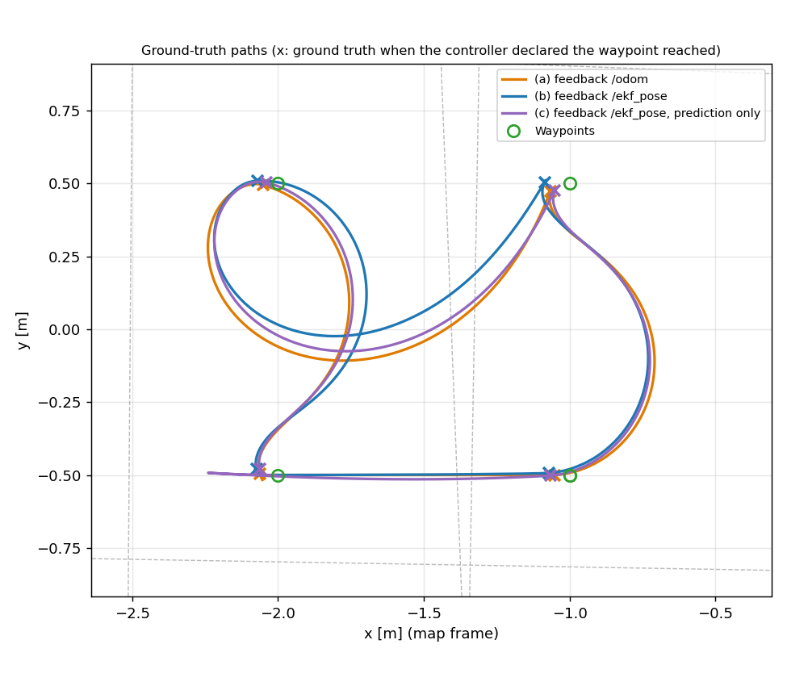
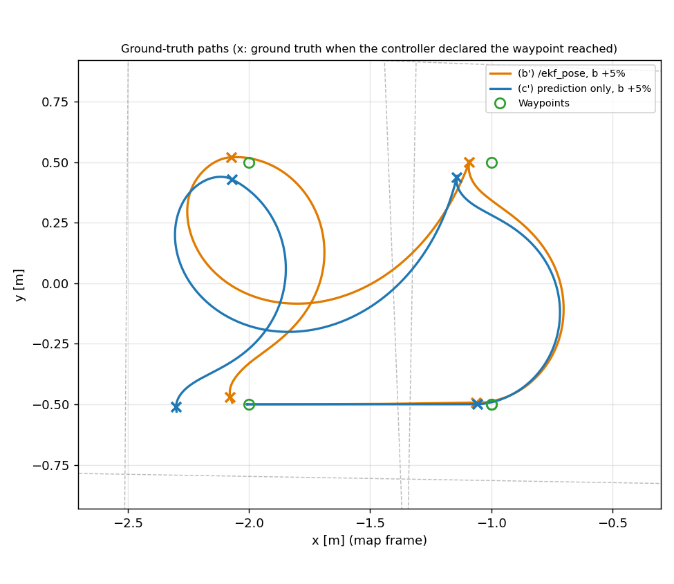
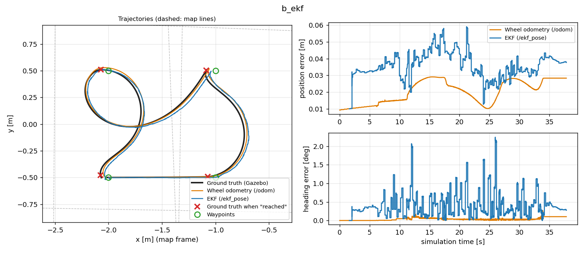
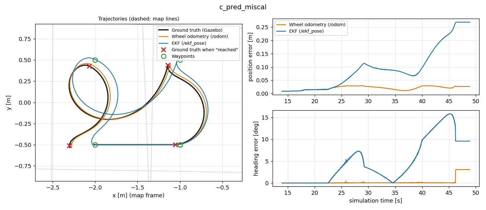
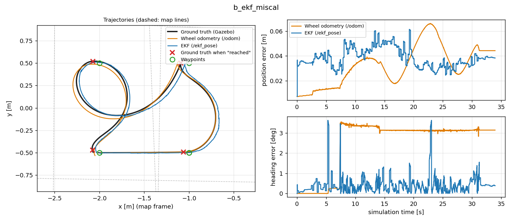
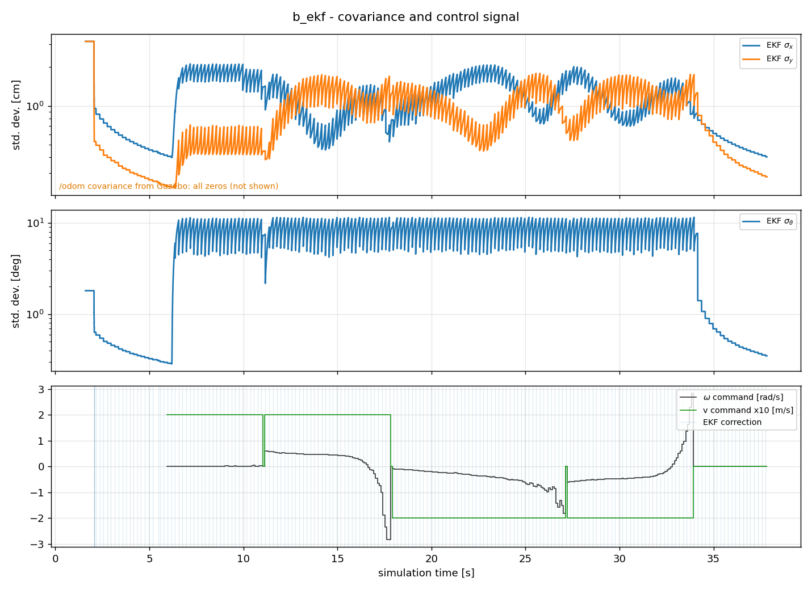

# TurtleBot3 — EKF Localization with Lidar Line Features

A ROS 2 (Jazzy) package that localizes a TurtleBot3 Burger in a known environment with an **Extended Kalman Filter**.

- **Prediction** uses the wheel encoders (`/joint_states`).
- **Correction** extracts straight lines from each lidar scan with **Split-and-Merge**, associates them with a line map of the maze (Mahalanobis gating), and fuses all accepted lines in one update.
- **Waypoint mission:** a regulator drives through a list of waypoints. Its feedback is either the EKF estimate or the raw wheel odometry.

Built as the fourth assignment of the Autonomous Mobile Robots course at ETF Belgrade. It was originally written for ROS 2 Humble and Gazebo Classic, then revisited and fixed for this repository (see [What was fixed](#what-was-fixed-after-the-original-submission)).

---

## Contents

- [Task Description](#task-description)
- [Package Structure](#package-structure)
- [Algorithm](#algorithm)
- [Nodes, Topics and Parameters](#nodes-topics-and-parameters)
- [Build and Test](#build-and-test)
- [Running](#running)
- [Results](#results)
- [What was fixed after the original submission](#what-was-fixed-after-the-original-submission)
- [Known Limitations](#known-limitations)
- [Reproducing the Results](#reproducing-the-results)

---

## Task Description

| Task | Description | Module |
|------|-------------|--------|
| 1 | Motion model of the differential drive and covariance prediction | `motion_model.py` |
| 2 | Measurement model: predicted line parameters for a map line, seen from a pose | `measurement_model.py` |
| 3 | Data association of observed lines with map lines (validation gate `g`) | `data_association.py` |
| 4 | EKF correction step | `ekf_update.py` |
| 5 | ROS 2 node `ekf_line_localization`: `/joint_states` + `/scan` → `/ekf_pose` | `ekf_line_localization.py`, `split_and_merge.py` |
| 6 | Regulator from the differential-drive assignment, closed over `/ekf_pose`, driving a waypoint mission | `waypoint_mission.py` |
| 7 | Experiment: the mission with feedback from (a) `/odom`, (b) `/ekf_pose`, (c) `/ekf_pose` without the correction step | [Results](#results) |

---

## Package Structure

```text
TurtleBot3-EKF-Localization/
├── ekf_localization/                    # ROS 2 package (ament_python)
│   ├── ekf_localization/
│   │   ├── motion_model.py              # Task 1: transitionFunction, predictCovariance
│   │   ├── measurement_model.py         # Task 2: measurementFunction
│   │   ├── data_association.py          # Task 3: associateMeasurements
│   │   ├── ekf_update.py                # Task 4: filterStep
│   │   ├── split_and_merge.py           # Line extraction (+ /lines visualization node)
│   │   ├── ekf_line_localization.py     # Task 5: EKF node
│   │   └── waypoint_mission.py          # Task 6: waypoint mission, EKF or odometry feedback
│   ├── launch/ekf_localization.launch.py
│   ├── maps/maze_lines.yaml             # Line map of the TurtleBot3 maze (11 walls, world frame)
│   ├── rviz/ekf_localization.rviz
│   ├── test/test_ekf_math.py            # Offline unit tests (pytest)
│   ├── package.xml
│   └── setup.py
├── tools/                               # Task 7: scripts used to produce the results below
│   ├── sim_headless.launch.py           # Maze world without GUI + ground-truth bridge
│   ├── record_trajectories.py           # Ground truth, /odom, /ekf_pose, /cmd_vel -> CSV
│   ├── plot_results.py                  # Trajectory, error, covariance and cmd_vel plots
│   └── replay_bag.py                    # Offline replay of a bag through the filter (gate study)
└── docs/                                # Result figures
```

The Split-and-Merge implementation here is a newer version of the one in [`TurtleBot3-Split-And-Merge`](../TurtleBot3-Split-And-Merge). It adds two things:

- a merge step for adjacent, nearly collinear segments, including the wrap-around between the last and first beam;
- normalization of every line to `ρ ≥ 0`, which the measurement model relies on.

It is kept inside this package so that the earlier assignment stays unchanged.

---

## Algorithm

### State and frames

The state is the planar pose `x = [x, y, θ]ᵀ` in the **map frame**. It is the same frame as the Gazebo world: the walls in `maze_lines.yaml` are written in world coordinates.

- The robot spawns at `(-2.0, -0.5, 0)` (the default of `turtlebot3_maze.launch.py`), so the filter starts there with `P₀ = 0.001 · I`.
- `/odom` starts at the spawn pose, so the launch file publishes `map → odom` as that pose.

### Prediction — wheel encoders (Task 1)

On every `/joint_states` message, the wheel angle increments are converted to travelled distances `Δs_l = r·Δφ_l` and `Δs_r = r·Δφ_r`, with `r = 0.033 m`. Then:

```
Δs = (Δs_r + Δs_l) / 2
Δθ = (Δs_r − Δs_l) / (2b)              b = 0.08 m (half of the 0.160 m wheel separation)

x̂ = x + Δs·cos(θ + Δθ/2)
ŷ = y + Δs·sin(θ + Δθ/2)
θ̂ = θ + Δθ
```

The covariance is propagated with the Jacobians with respect to the state (`F_x`) and the input (`F_u`). The input noise is proportional to the distance each wheel travels:

```
Q = diag(k·|Δs_l|, k·|Δs_r|)           k = 0.01
P̂ = F_x P F_xᵀ + F_u Q F_uᵀ
```

> The assignment text writes `(Δs_l − Δs_r)/2b` with `b = 0.160 m`. That has the opposite sign of the ROS convention (counter-clockwise positive), and it divides by twice the full wheel separation. The code uses the ROS convention with `b` as half the separation, which matches what the Gazebo robot actually does.

### Line extraction — Split-and-Merge

1. Each scan is converted to Cartesian points in the robot frame, including the lidar's mounting offset (`base_scan` is 3.2 cm behind `base_footprint`).
2. The points are segmented recursively: a segment is split at the point farthest from the chord through its end points, as long as that distance exceeds 0.08 m.
3. Segments with more than four points become lines.
4. Adjacent lines with similar parameters (`|Δθ| < 0.12 rad`, `|Δρ| < 0.2 m`) are merged.

Every line is reported in Hesse normal form `(α, r)`, with `r ≥ 0`.

### Measurement model (Task 2)

A map line `m = (α_m, r_m)` is given in the map frame. Its prediction in the robot frame is

```
ẑ = [ α_m − θ ,  r_m − (x·cos α_m + y·sin α_m) ]ᵀ

H = [  0         0        −1 ]
    [ −cos α_m  −sin α_m    0 ]
```

### Data association (Task 3)

Each observed line `z_j` has noise `R_j = diag(σ_α², σ_r²)`, with `σ_α = 0.05 rad` and `σ_r = 0.02 m`. For every pair of `z_j` and map line `m_i`:

```
v_ij = z_j − ẑ_i                    (angle component wrapped to [−π, π])
S_ij = H_i P̂ H_iᵀ + R_j
d_ij = v_ijᵀ S_ij⁻¹ v_ij             (squared Mahalanobis distance)
```

The closest map line is accepted if `d < g²`, with `g = 3`. All accepted innovations, Jacobians and noise matrices are stacked into `v̂`, `Ĥ` and a block-diagonal `R̂`.

### Correction (Task 4) and timing (Task 5)

```
S = Ĥ P̂ Ĥᵀ + R̂
K = P̂ Ĥᵀ S⁻¹
x = x̂ + K v̂                         (θ wrapped to [−π, π])
P = (I − K Ĥ) P̂
```

The assignment asks for the correction to use the prior propagated to the **scan's timestamp**, not to the time the message arrives. The node does this as follows:

1. It keeps the last 2 s of prediction steps.
2. When a scan arrives, it applies the correction to the state as it was at the scan's timestamp.
3. It then re-applies the wheel increments that came in after that timestamp.

In Gazebo the scan arrives about 40 ms after its stamp. If no line passes the gate, the prediction is kept. `/ekf_pose` is published after every prediction step, so the regulator gets feedback at the odometry rate.

### Waypoint mission (Task 6)

- **Controller.** The polar-coordinate controller from the [differential-drive assignment](../TurtleBot3-Differential-Drive-Control): `ω = k_α·α + k_β·β`, rescaled so that the linear speed is 0.2 m/s. It drives in reverse when the target is behind the robot.
- **Limits.** Commands are clipped to the Burger's limits, `|v| ≤ 0.22 m/s` and `|ω| ≤ 2.84 rad/s`.
- **Waypoints.** The reference poses are given in the map frame. The default is a 1 m × 1 m square starting at the spawn pose: `(-1,-0.5) → (-1,0.5) → (-2,0.5) → (-2,-0.5)`.
- **Tolerance.** A waypoint counts as reached within 5 cm of the estimate.
- **Feedback.** `use_ekf` selects `/ekf_pose` or `/odom`. With `/odom`, the pose is first transformed into the map frame, so the reference poses mean the same thing in every configuration.

---

## Nodes, Topics and Parameters

### `ekf_line_localization`

| Direction | Topic | Type |
|-----------|-------|------|
| Subscribes | `/joint_states` | `sensor_msgs/JointState` |
| Subscribes | `/scan` | `sensor_msgs/LaserScan` |
| Publishes | `/ekf_pose` | `geometry_msgs/PoseWithCovarianceStamped` (frame `map`) |

| Parameter | Default | Description |
|-----------|---------|-------------|
| `map_path` | `share/ekf_localization/maps/maze_lines.yaml` | Line map |
| `initial_x`, `initial_y`, `initial_theta` | `0.0` (launch file: spawn pose `-2.0, -0.5, 0.0`) | Initial pose in the map frame |
| `wheel_radius` | `0.033` | m |
| `half_wheel_separation` | `0.08` | `b` in the motion model, m |
| `odom_noise_k` | `0.01` | `k` in `Q` |
| `lidar_offset_x` | `-0.032` | `base_scan` position along x in `base_footprint`, m |
| `split_threshold` | `0.08` | Split-and-Merge distance threshold, m |
| `sigma_alpha`, `sigma_r` | `0.05`, `0.02` | Line measurement noise (rad, m) |
| `gate` | `3.0` | Validation gate `g` (accept if `d < g²`) |
| `use_scan` | `true` | `false` runs prediction only (configuration c) |
| `history_length` | `2.0` | Seconds of prediction steps kept for the scan-time correction |

For each scan the node logs the number of extracted and associated lines, the correction applied and the processing time.

### `split_and_merge_node`

Subscribes to `/scan` and publishes the extracted lines as `visualization_msgs/MarkerArray` on `/lines` (for RViz).

### `waypoint_mission`

Subscribes to `/odom` and `/ekf_pose`, and publishes `geometry_msgs/TwistStamped` on `/cmd_vel`.

| Parameter | Default | Description |
|-----------|---------|-------------|
| `use_ekf` | `true` | Feedback from `/ekf_pose` (`true`) or `/odom` (`false`) |
| `waypoints` | `[-1.0, -0.5, -1.0, 0.5, -2.0, 0.5, -2.0, -0.5]` | Flat list `x1, y1, x2, y2, ...` in the map frame |
| `odom_x`, `odom_y`, `odom_yaw` | `-2.0`, `-0.5`, `0.0` | Pose of `odom` in `map`, used with `/odom` feedback |
| `tolerance` | `0.05` | m |

> The assignment specifies `geometry_msgs/Twist`. The TurtleBot3 Jazzy Gazebo bridge only accepts `TwistStamped` on `/cmd_vel`, so the mission publishes that.

---

## Build and Test

Tested on Ubuntu 24.04 with ROS 2 Jazzy and Gazebo Harmonic (`gz sim` 8).

```bash
sudo apt install ros-jazzy-turtlebot3-gazebo ros-jazzy-tf-transformations
cd ~/ros2_ws/src
git clone https://github.com/MihStev/ROS2.git
cd ~/ros2_ws
colcon build --packages-select ekf_localization
source install/setup.bash
colcon test --packages-select ekf_localization --event-handlers console_direct+
```

The tests in `test/test_ekf_math.py` need no simulator. They check:

- the analytic Jacobians `F_x`, `F_u` and `H` against numerical differentiation;
- line extraction and association on a synthetic room;
- that the filter keeps the drift of a biased odometry bounded.

---

## Running

```bash
export TURTLEBOT3_MODEL=burger

# Terminal 1 — simulation (the robot spawns at (-2.0, -0.5))
ros2 launch turtlebot3_gazebo turtlebot3_maze.launch.py

# Terminal 2 — EKF + line visualization + RViz
ros2 launch ekf_localization ekf_localization.launch.py

# ...with the waypoint mission: (a) use_ekf:=false, (b) default, (c) use_scan:=false
ros2 launch ekf_localization ekf_localization.launch.py mission:=true use_ekf:=true use_scan:=true
```

If the robot is spawned somewhere else, pass the same pose to the launch file (`x_pose:=... y_pose:=... yaw:=...`). The filter, the `map → odom` transform and the mission all depend on it. In RViz the EKF pose is shown with its covariance ellipse, together with the scan and the extracted lines.

---

## Results

> **Summary.**
> - **When the filter starts at the spawn pose,** it associates about 5–6 map lines per scan. Its error stays below 6 cm for the whole mission (RMSE 3.7 cm).
> - **With nominal odometry,** Gazebo's wheel odometry is almost perfect (about 2 cm over the lap), so the filter cannot improve on it. Its error is bounded by the accuracy of the line map, which is a few cm.
> - **With a 5 % wheel-separation error** in the filter's model, the results show what the assignment expects. Prediction alone drifts to 27 cm and misses the last waypoint by 30 cm. The full EKF stays at 3.8 cm.

### Setup

- **Simulator:** Gazebo Harmonic, TurtleBot3 Burger in the maze world, headless, Ubuntu 24.04 / WSL2.
- **Ground truth:** taken from the simulator (`/world/default/dynamic_pose/info`).
- **Mission:** each run drives the square once, which takes about 35 s of simulation time and 180–190 scans.
- **Path shape:** the path between waypoints is not a straight line. The regulator from the differential-drive assignment is used unchanged, and it drives arcs and reverses when the next waypoint is behind the robot.

### Experiment (Task 7)

| Configuration | Feedback | Odometry error (RMSE / final) | EKF error (RMSE / final) | Ground truth distance to waypoint when "reached" |
|---|---|---|---|---|
| (a) | `/odom` | 2.2 / 2.8 cm | 3.9 / 3.9 cm | 5.2, 7.1, 5.2, 6.2 cm |
| (b) | `/ekf_pose` | 2.1 / 2.8 cm | **3.7 / 3.8 cm** | 7.1, 8.6, 7.0, 7.7 cm |
| (c) | `/ekf_pose`, prediction only | 1.7 / 2.4 cm | 1.7 / 2.4 cm | 6.5, 5.7, 3.9, 6.5 cm |
| (b') | `/ekf_pose`, filter uses `b` +5 % | 3.6 / 4.4 cm | **3.9 / 3.8 cm** | 6.1, 9.0, 7.5, 8.2 cm |
| (c') | `/ekf_pose`, prediction only, `b` +5 % | 2.2 / 2.7 cm | 12.4 / **26.9 cm** | 5.6, 15.5, 9.9, **30.1** cm |

How to read the table:

- **Waypoint distance.** "Reached" means the estimate is within 5 cm, so even a perfect estimate leaves up to 5 cm here. The rest is estimation error.
- **"Odometry error"** is `/odom` from Gazebo in every row. In (b') and (c') it is not affected by the miscalibration, which exists only inside the filter.
- **(a) and (c) do not degrade here, unlike on a real robot.** The assignment expects them to degrade in the same way, because both rely on dead reckoning only. In Gazebo Harmonic, though, the wheels do not slip and their geometry matches the model exactly, so dead reckoning hardly drifts.
- **Rows (b') and (c') stand in for a real calibration error.** They add a 5 % error to the filter's wheel separation (`half_wheel_separation:=0.084`), so the drift becomes visible. (c') drifts like real odometry would, and (b') removes it.





**Estimation error, configuration (b).** The EKF error stays between 1 and 6 cm. It does not grow, but it stays above the odometry's 2 cm, because the line map itself is accurate only to a few centimetres (see below).



**Prediction only with 5 % wheel-separation error (c').** The heading error grows by about 1° per turn, and the position error grows with it. Nothing pulls the estimate back.



The same miscalibration with the correction step (b'):



### Covariance and control signal



- **EKF covariance.** While the robot stands still, `P` shrinks with every scan. While it drives, `P` grows between scans and drops back at every correction (5 Hz), which gives the saw-tooth.
  - `σ_x` and `σ_y` stay between about 0.5 and 3 cm.
  - `σ_θ` oscillates between about 5° and 10°. The assignment's `k = 0.01` is a large noise: the standard deviation is about 10 cm of wheel travel per metre driven. Most of the heading information therefore comes from the lines.
- **`/odom` covariance.** Gazebo publishes a covariance of all zeros on `/odom`. It claims perfect certainty and is not usable for fusion, so it is only noted in the figure.
- **Effect of corrections on control.**
  - The corrections are a few millimetres per scan once the filter has converged. They do not visibly change `/cmd_vel` (vertical lines in the bottom panel).
  - The large spikes in `ω` come from the controller itself. It divides by `ρ` when rescaling to a constant speed, so `ω` grows as the robot gets close to a waypoint. The new clipping to 2.84 rad/s limits them.
  - With the original, wrong initial pose, the corrections were 2–5 cm jumps. Those would have shown up directly in `ω`.

### Validation gate `g`

The recording of run (a) was replayed offline through the same filter functions (`tools/replay_bag.py`). For every accepted line, the replay also checks which map line it would match at the true pose.

| Gate `g` | Lines per scan | Accepted: correct / other map line / no map match | RMSE | Final |
|---|---|---|---|---|
| 5 | 5.98 | 1133 / 43 / 14 | 4.0 cm | 3.9 cm |
| 3 (default) | 5.79 | 1107 / 42 / 4 | 3.9 cm | 3.8 cm |
| 2 | 5.50 | 1053 / 39 / 2 | 3.8 cm | 3.7 cm |
| 1 | 4.53 | 886 / 16 / 0 | 3.5 cm | 3.5 cm |

Dead reckoning alone on this recording ends 2.8 cm from the truth. With `b` +5 % it ends 28.1 cm away, while the EKF result is unchanged for every gate.

- **Gate size.** A larger gate accepts more lines, including ones without a real counterpart in the map. A smaller gate rejects more correct lines: at `g = 1`, about 20 % of them. Because the map is good, the trade-off is mild here.
  - It mattered a lot with the wrong initial pose. There, `g = 3` gave 0.34 m final error and `g = 1` gave 0.07 m, because the gate was the only thing that rejected wrong matches.
- **"Other map line."** These are mostly two map entries for the same physical wall, for example two nearly collinear wall segments listed separately.
- **Where a constant `R` fits worst.**
  - Short segments seen at long range, and segments that cut across a corner. Their parameters are much less certain than `σ_r = 2 cm`, yet they get the same weight.
  - While the robot turns quickly, the scan is distorted by the motion during the 0.2 s sweep.

  In both cases the innovations are the largest.

### Run time

Scan processing (line extraction, association and update) took a median of **5.4 ms**, 9.9 ms at the 95th percentile and 20 ms at most, over 194 scans (Python, WSL2). The lidar runs at 5 Hz. Prediction runs on every `/joint_states` message, which Gazebo publishes at about 1 kHz.

---

## What was fixed after the original submission

The submitted version, rerun in Gazebo Harmonic, was **worse than wheel odometry**:

- 0.30 m RMSE, with odometry at 0.02 m;
- the robot once drove into a wall with EKF feedback.

The cause was found by replaying a recorded bag and comparing the lidar lines with the map at the true pose.

1. **Wrong initial pose (the main error).**
   - `maze_lines.yaml` is in **world coordinates**. Fitted against the walls in `maze.world`, its origin coincides with the world origin to within 2 cm and 0.25°, and individual walls are within 1–5 cm.
   - The filter, however, started at `(0, 0, 0)` while the robot spawns at `(-2.0, -0.5)`. Every prediction was therefore off by 2 m.
   - The gate accepted only about 1.4 lines per scan, mostly coincidental matches, and each one pulled the estimate a few centimetres in the wrong direction.
   - The filter now starts at the spawn pose. This alone brings the replay error from 0.35 m to 0.05 m, with 5.7 lines associated per scan.
   - If the original Humble setup spawned the robot at the world origin, the code would have been correct there.
2. **Lidar mounting offset.** Scan points are now shifted by the 3.2 cm offset of `base_scan`. This takes the error from 5 cm to about 3 cm.
3. **Scan timestamp.** The correction now uses the prior at the scan's timestamp, as the assignment requires. In this simulation the lag is only about 40 ms and the effect is below 1 mm. It matters with a slower computer or a real robot.
4. **Motion model.** It now uses the midpoint heading `θ + Δθ/2` from the assignment instead of `θ + Δθ`, with the Jacobians updated. At 1 kHz the numerical difference is negligible.
5. **Mission.**
   - Waypoints are now given in the map frame, and `/odom` feedback is transformed into it, as Note 2 of the assignment requires.
   - Velocity commands are clipped to the Burger's limits.
   - `/cmd_vel` uses `TwistStamped` for the Jazzy bridge.

The line extraction, association and update code (Tasks 2–4) is unchanged.

---

## Known Limitations

1. **Map accuracy.** Seen from the true pose, the walls in `maze_lines.yaml` are off by 1–5 cm, and a few map angles are off by up to 2°. The filter's error is bounded by this.
2. **Infinite lines.** Map walls are infinite lines with no segment extent. An observed segment can therefore match a wall that lies far away along the same line, and collinear walls cannot be told apart.
3. **Negative `r` is not handled.** If the robot is on the other side of a map line than the map origin, the predicted `r` is negative. The lidar always reports `r ≥ 0` with the angle flipped, so such lines are rejected. Along this mission it does not happen.
4. **Fixed line noise.** Lines are fitted through the segment end points, not by least squares, and `R` is the same for every line regardless of range or number of points.
5. **No global localization.** The initial pose must be known, and the filter cannot recover from a large error, because association only searches near the current estimate.
6. The covariance update uses `(I − K H) P` rather than the Joseph form.
7. **Simulated odometry is nearly ideal.** That is why the drift in (c') was injected through the filter's own model rather than coming from the simulator.

---

## Reproducing the Results

```bash
export TURTLEBOT3_MODEL=burger
cd ~/ros2_ws/src/ROS2/TurtleBot3-EKF-Localization

ros2 launch tools/sim_headless.launch.py &                       # Gazebo without GUI, spawn (-2.0, -0.5)
ros2 run ekf_localization ekf_line_localization --ros-args -p use_sim_time:=true \
    -p initial_x:=-2.0 -p initial_y:=-0.5 -p use_scan:=true -p half_wheel_separation:=0.08 &
python3 tools/record_trajectories.py --out run.csv &
ros2 bag record -o bag /scan /joint_states /ground_truth/poses &  # only needed for the gate study
ros2 run ekf_localization waypoint_mission --ros-args -p use_sim_time:=true -p use_ekf:=true
# stop the recorders (Ctrl+C) after the fourth "Target reached!"

python3 tools/plot_results.py run.csv --map ekf_localization/maps/maze_lines.yaml \
    --out run.png --details run_details.png
python3 tools/plot_results.py a.csv b.csv c.csv --labels "(a)" "(b)" "(c)" \
    --map ekf_localization/maps/maze_lines.yaml --out compare.png
python3 tools/replay_bag.py bag --map ekf_localization/maps/maze_lines.yaml --gate 5 3 2 1
```

Settings for each configuration:

| Configuration | `use_ekf` | `use_scan` | `half_wheel_separation` |
|---|---|---|---|
| (a) | `false` | `true` | `0.08` |
| (b) | `true` | `true` | `0.08` |
| (c) | `true` | `false` | `0.08` |
| (b'), (c') | as (b) and (c) | as (b) and (c) | `0.084` |

The simulation is not deterministic, so individual numbers vary by a centimetre or so between runs.
